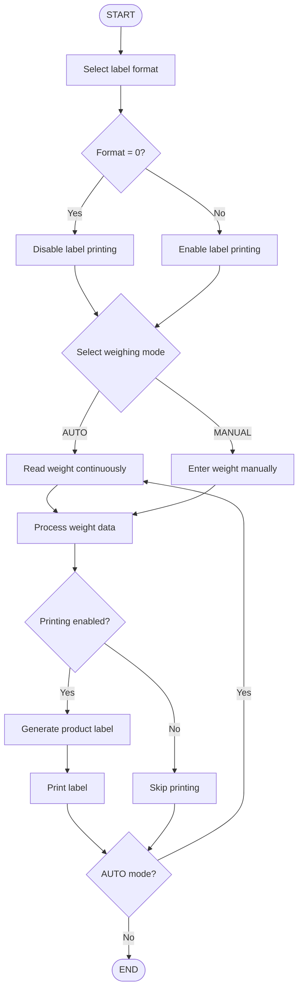

 <div align="center">

# `LabelingConsoleApp`

### <span style="color:#00F5FF">WEIGH.</span> <span style="color:#B026FF">PROCESS.</span> <span style="color:#00F5FF">LABEL.</span>

**A console-based product weighing and label printing application built with C# and .NET 8.**


[](https://dotnet.microsoft.com/)
[](https://learn.microsoft.com/dotnet/csharp/)
[](https://github.com/BudynRadzik/LabelingConsoleApp)
[](https://github.com/BudynRadzik/LabelingConsoleApp)

</div>

---

## `// NAVIGATION`

| | | |
|:---:|:---:|:---:|
| [ABOUT](#about) | [FEATURES](#features) | [TECH STACK](#tech-stack) |
| [REQUIREMENTS](#requirements) | [INSTALLATION](#installation) | [WORKFLOW](#application-workflow) |
| [WEIGHING](#weighing-modes) | [PRINTING](#label-printing) | [MENU](#application-menu) |
| [CONFIGURATION](#configuration) | [ROADMAP](#roadmap) | [LICENSE](#license) |

---

<a id="about"></a>
## `01 // ABOUT`

**LabelingConsoleApp** is a C# console application designed to support product weighing and label printing in a production or retail environment.

The application connects the weighing process with label generation and printing. It supports two weighing modes:

- **AUTO** — continuously reads weight data from a connected weighing scale.
- **MANUAL** — allows the operator to enter the weight manually.

Depending on the selected label format, the application can generate and print product labels or run without printing in simulation mode.

The project has been tested with:

- **Zebra LP 2844** label printer (USB, ZPL/EPL).
- **OHAUS DEFENDER 2200** weighing scale (RS232 or RS232-to-USB converter).

---

<a id="features"></a>
## `02 // FEATURES`

- Automatic weighing mode with continuous weight reading.
- Manual weighing mode with operator-entered values.
- Product label generation.
- Label printing support.
- Configurable label format.
- Configurable label quantity.
- Console-based operation.
- Simulation mode without a printer.
- Hardware integration with supported weighing and printing devices.

---

<a id="tech-stack"></a>
## `03 // TECH STACK`

<div align="center">

[](https://skillicons.dev)

</div>

| Technology | Purpose |
|---|---|
| C# | Application development |
| .NET 8 | Runtime and framework |
| Console Application | User interface |
| RS232 / USB | Scale communication |
| ZPL / EPL | Label printer languages |

---

<a id="requirements"></a>
## `04 // REQUIREMENTS`

### Software

- .NET 8 SDK.
- Windows recommended for the tested USB hardware setup.
- A terminal or command-line environment.

### Hardware (optional)

| Device | Connection | Purpose |
|---|---|---|
| Zebra LP 2844 | USB | Label printing |
| OHAUS DEFENDER 2200 | RS232 / RS232-to-USB | Product weighing |

> **Simulation mode:** You do not need a physical scale or printer to explore the application. Select `MANUAL` weighing and set the label format to `0`.

---

<a id="installation"></a>
## `05 // INSTALLATION`

### 1. Clone the repository

```bash
git clone https://github.com/BudynRadzik/LabelingConsoleApp.git
```

### 2. Navigate to the project directory

```bash
cd LabelingConsoleApp
```

### 3. Restore dependencies

```bash
dotnet restore
```

### 4. Build the application

```bash
dotnet build
```

### 5. Run

```bash
dotnet run
```

---

<a id="application-workflow"></a>
## `06 // APPLICATION WORKFLOW`

The application starts by asking the operator to select a label format and weighing mode.



### Workflow overview

1. Select the label format.
2. Select the weighing mode.
3. Acquire weight data automatically or enter it manually.
4. Process the weight.
5. Generate and print a label if printing is enabled.
6. In AUTO mode, continue reading weight data.

---

<a id="weighing-modes"></a>
## `07 // WEIGHING MODES`

### AUTO mode

- Reads weight data continuously from the connected scale.
- Processes incoming weight values.
- Supports an ongoing weighing workflow.

### MANUAL mode

- Allows the operator to enter the weight directly.
- Does not require a connected weighing scale.
- Useful for testing and simulation.

---

<a id="label-printing"></a>
## `08 // LABEL PRINTING`

The application supports label printing using a compatible printer.

### Tested printer

**Zebra LP 2844**

- USB connection.
- ZPL / EPL printer language support.

### Label format

The selected label format determines whether the application should generate and print labels.

| Setting | Behaviour |
|---|---|
| `0` | Printing disabled |
| Other configured format | Label generation and printing enabled |

> The actual available label formats depend on the application's configuration.

---

<a id="application-menu"></a>
## `09 // APPLICATION MENU`

The application provides menu options for managing the weighing and printing process.

Available options include:

- Change label format.
- Change label quantity.
- Select the weighing mode.
- Continue with the weighing workflow.

---

<a id="configuration"></a>
## `10 // CONFIGURATION`

### Running without hardware

To test the application without a physical scale or printer:

1. Start the application.
2. Select `MANUAL` weighing mode.
3. Set the label format to `0`.
4. Enter the weight manually when prompted.

With label format `0`, printing is disabled. This allows the application to be explored without connecting external devices.

### Hardware setup

For a physical setup:

- Connect the Zebra LP 2844 printer via USB.
- Connect the OHAUS DEFENDER 2200 scale using RS232 or an RS232-to-USB converter.
- Make sure the required device drivers and operating-system settings are configured.

---

<a id="roadmap"></a>
## `11 // ROADMAP`

Potential future improvements:

- [ ] Extended printer configuration.
- [ ] Additional printer models.
- [ ] More weighing scale integrations.
- [ ] Improved error handling and diagnostics.
- [ ] Expanded configuration options.
- [ ] More flexible label templates.

---

<a id="screenshots"></a>
## `12 // SCREENSHOTS`

Application screenshots can be added here.

```text
docs/
└── screenshots/
    ├── main-menu.png
    ├── weighing-mode.png
    └── label-printing.png
```

Example Markdown:

```markdown

```

---

<a id="license"></a>
## `13 // LICENSE`

No license information has been specified yet.

---

<div align="center">

### `SYSTEM STATUS: READY`

**Developed with C# and .NET 8**

[](https://github.com/BudynRadzik/LabelingConsoleApp)


</div>
