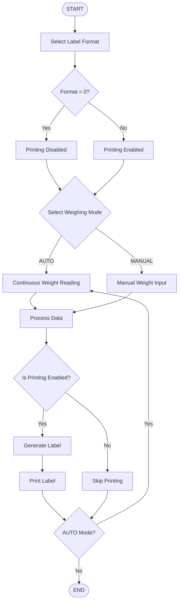

 <div align="center">

</div>

## 🗺️ Project Navigation

| Section | Description |
|---|---|
| [About the Project](#1-about-the-project) | Application purpose and overview |
| [Technologies](#2-technologies-used) | Technology stack |
| [Features](#3-features) | Main application capabilities |
| [Requirements](#4-requirements) | Software and hardware requirements |
| [Installation](#5-installation-and-running) | How to run the project |
| [Application Workflow](#6-application-workflow) | Process diagram |
| [Weighing Modes](#7-weighing-modes) | AUTO and MANUAL modes |
| [Label Printing](#8-label-printing) | Printer configuration |
| [Application Menu](#9-application-menu) | Available options |
| [Configuration](#10-configuration-and-testing) | Testing without hardware |
| [Future Development](#11-future-development) | Possible improvements |
| [Screenshots](#12-screenshots) | Application screenshots |
| [License](#13-license) | License information |

---

<a id="1-about-the-project"></a>
<h2>1. About the Project 👋</h2>

**LabelingConsoleApp** is a console application written in C# using the .NET 8 platform.

Its main purpose is to handle product weighing processes and generate and print labels based on the measured weight.

The application was designed to work with devices commonly used in weighing and labeling processes.

The project supports two operating modes:

- **AUTO** — automatic, continuous weight readings from a connected scale.
- **MANUAL** — manual weight input by the operator.

The application can also run without a physical scale or printer, using a test mode with label printing disabled.

### Tested Devices

| Device | Model | Communication |
|---|---|---|
| Label Printer | Zebra LP 2844 | USB, ZPL/EPL |
| Scale | OHAUS DEFENDER 2200 | RS232 / RS232-USB |

---

<a id="2-technologies-used"></a>
<h2>2. Technologies Used 🛠️</h2>

<div align="center">

[](https://skillicons.dev)

</div>

| Technology | Purpose |
|---|---|
| C# | Main programming language |
| .NET 8 | Runtime platform |
| Console Application | User interface |
| RS232 / USB | Device communication |
| ZPL / EPL | Label printer command languages |

---

<a id="3-features"></a>
<h2>3. Features ✨</h2>

Main application features:

- Automatic weight readings from a connected scale.
- Manual weight input.
- Processing of weighing data.
- Product label generation.
- Label printing on compatible printers.
- Label format selection.
- Ability to change the number of printed labels.
- Testing without connected hardware.
- Two operating modes: AUTO and MANUAL.

---

<a id="4-requirements"></a>
<h2>4. Requirements 💻</h2>

### Software

- .NET 8 SDK.
- Windows environment recommended for the tested hardware configuration.
- Terminal or command prompt.

### Hardware — Optional

| Device | Model | Connection |
|---|---|---|
| Label Printer | Zebra, Godex, etc. | USB |
| Scale | Any scale with RS232 support | RS232 or RS232-to-USB converter |

**Don't have the required hardware?**

You can still run the application in test mode. Simply select the `MANUAL` mode and set the label format to `0`.

---

<a id="5-installation-and-running"></a>
<h2>5. Installation and Running 📦</h2>

### Step 1 — Clone the Repository

```bash
git clone https://github.com/BudynRadzik/LabelingConsoleApp.git
```

### Step 2 — Navigate to the Project Directory

```bash
cd LabelingConsoleApp
```

### Step 3 — Restore Dependencies

```bash
dotnet restore
```

### Step 4 — Build the Project

```bash
dotnet build
```

### Step 5 — Run the Application

```bash
dotnet run
```

---

<a id="6-application-workflow"></a>
<h2>6. Application Workflow 🧩</h2>

The following diagram illustrates the main application workflow — from selecting a label format, through obtaining the weight, to optionally printing the label.



### Process Overview

1. The operator selects a label format.
2. The operator selects a weighing mode.
3. The application automatically reads the weight from the scale or accepts a manually entered value.
4. The weight data is processed.
5. If printing is enabled, the application generates and prints a label.
6. In AUTO mode, the weight reading process continues in a loop.

---

<a id="7-weighing-modes"></a>
<h2>7. Weighing Modes 🧪</h2>

### AUTO — Automatic Weighing

Designed for operation with a connected weighing scale.

- Continuous weight readings.
- Automatic data retrieval from the device.
- Processing of consecutive measurements.
- Support for continuous application operation.

### MANUAL — Manual Weighing

Allows the application to operate without a physically connected scale.

- The operator manually enters the weight value.
- No connection to a weighing device is required.
- Useful for application testing.

---

<a id="8-label-printing"></a>
<h2>8. Label Printing 📚</h2>

The application supports generating and printing product labels.

### Tested Printer

**Zebra LP 2844**

- USB connection.
- Support for ZPL/EPL printer languages.

### Label Format

The label format determines whether the application should perform the printing process.

| Format | Behavior |
|---|---|
| `0` | Printing disabled |
| Any other configured format | Label generation and printing enabled |

Available label formats depend on the application configuration.

---

<a id="9-application-menu"></a>
<h2>9. Application Menu 📜</h2>

The application provides a menu that allows the operator to change selected operating parameters.

Available options include:

- Changing the label format.
- Changing the number of labels to print.
- Selecting the weighing mode.
- Starting the weighing process.

---

<a id="10-configuration-and-testing"></a>
<h2>10. Configuration and Testing ⚙️</h2>

### Running Without a Scale or Printer

The application can be tested without connecting any external devices.

To do so:

1. Start the application.
2. Set the label format to `0` to disable label printing.

   This allows you to test the application without a physical printer.

   The default weighing mode is `MANUAL`, so no changes are necessary.
3. Select the first option: `New Weighing`.
4. Manually enter a weight value.

### Hardware Configuration

When working with external devices:

- Connect a Zebra, Godex, or another printer supporting ZPL/ZPLII/EZPL/EPL printer languages via USB.
- Check the printer name recognized by your computer. Then, in `Program.cs`, replace `{"ZDesigner LP 2844"}` with the actual printer name.
- Connect the scale via RS232 or an RS232-to-USB converter. Open **Device Manager** to check which COM port is assigned to your device.

  By default, `Program.cs` uses the `COM4` port. Replace it with the COM port currently assigned to your scale.
- Make sure all required drivers and system settings are correctly configured.
- A test label format is available in `Program.cs`, inside the `List<LabelFormat>` collection, under `Id = 2`.
- The file containing ZPL commands (defining the layout and positioning of label elements) is located in the `Labels` folder.
- To create a custom label, use an external application such as `Zebra Designer 3`. Once the label is ready, use the **Print to File** option to export it as a `.prn` file and place it in the `Labels` folder.
- To use the newly created label in the application, add it to the `List<LabelFormat>` collection in `Program.cs`.

  Assign the next available `Id`, provide a name, and specify the file path using the `Path` property.
- Dynamic fields used in the label template, such as `"{{WEIGHT}}"` or other placeholders, must be added to the `ZebraUsbLabelPrinter` class in the designated section.

### Example

```csharp
string payload = template
    .Replace("{{WEIGHT}}", weighing.Weight.ToString("0.###", CultureInfo.InvariantCulture))
    .Replace("{{DATE}}", weighing.WeighedAt.ToLocalTime().ToString("yyyy-MM-dd "));
```

---

<a id="11-future-development"></a>
<h2>11. Future Development 🎯</h2>

Possible directions for future improvements:

- [ ] Extended printer configuration options.
- [ ] Support for additional printer models.
- [ ] Integration with more weighing scale models.
- [ ] Improved error handling and diagnostics.
- [ ] Additional configuration options.
- [ ] More flexible label templates.
- [x] Application language selection.

---

<a id="12-screenshots"></a>
<h2>12. Screenshots</h2>

This section can contain screenshots demonstrating the application in action.

Example of how to add an image:

```markdown

```

---

<a id="13-license"></a>
<h2>13. License</h2>

License information has not yet been specified.

---

<div align="center">


</div>
