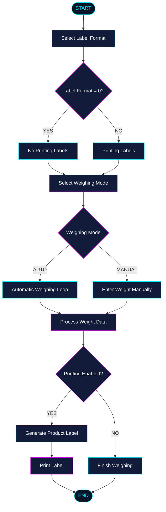

<p align="center">
  
</p>

<p align="center">
  
</p>

<p align="center">
  
  
  
  
</p>

<p align="center">
  <b>⚡ WEIGH. PROCESS. PRINT. ⚡</b>
</p>

---

## 🌌 About The Project

**LabelingConsoleApp** is a C# console application built on **.NET 8**, designed to handle product weighing and label printing.

The application provides a solution for processing weighed products and generating labels containing information about the weighed items.

Its purpose is to simplify the weighing and labeling workflow while providing a lightweight and straightforward console-based environment.

### 🎯 Main Goals

- ⚖️ Product weighing.
- 🖨️ Printing labels for weighed products.
- ⚡ Streamlining the weighing and labeling process.
  

---

## 🛠️ Tech Stack

<p align="center">
  
</p>

| Technology | Description |
|:---|:---|
| 💜 C# | Main programming language |
| ⚡ .NET 8 | Application framework |
| 💻 Console | Application interface |
| 🛠️ Visual Studio 2022 | Development environment |
| 🐙 Git | Version control |

---

## ⚙️ Features

| Feature | Description |
|:---|:---|
| ⚖️ Product Weighing | Handles product weighing |
| 🖨️ Label Printing | Prints product labels |
| 💻 Console Interface | Lightweight command-line application |
| 🚀 .NET 8 | Built on modern .NET technology |

---

## 📋 Requirements

Before running the application, make sure you have:

- [.NET 8 SDK](https://dotnet.microsoft.com/download/dotnet/8.0)
- [Git](https://git-scm.com/)
- A compatible operating system (Windows, Linux or macOS)
- Zebra printer or other printer using ZPL /EPL language. Im using Zebra 2844 USB.
- Scale with RS232 Protocol or converter RS232/USB. Im using OHAUS DEFENDER 2200
  if you want to tes the app without any devices you need to:
  Select in menu manual weighing  and chanage label format on" 0"
- If you chose Label Format "0" you can use application without printing labels (simulate in console window)

---

## 🚀 Installation

### 1. Clone the repository

```bash
git clone https://github.com/BudynRadzik/LabelingConsoleApp.git
```

### 2. Navigate to the project directory

```bash
cd LabelingConsoleApp
```

### 3. Restore dependencies

```bash
dotnet restore
```

### 4. Build the application

```bash
dotnet build
```

### 5. Run the application

```bash
dotnet run
```

---

## 🏗️ Project Workflow

The application supports two operating modes depending on the selected label format.

### 🔄 Main Workflow



### ⚖️ Weighing Modes

The application supports two different weighing modes:

| Mode | Description |
|:---|:---|
| 🔄 **AUTO** | Automatic weighing. The application continuously reads weight data in a loop and processes subsequent products. |
| ✍️ **MANUAL** | Manual weighing. The user enters the product weight directly through the console. |

**AUTO Mode**
- Continuously reads weight data.
- Processes products automatically in a loop.
- Generates and prints labels when printing is enabled.

**MANUAL Mode**
- Allows the user to enter product weight manually.
- Processes the entered weight.
- Generates and prints labels when printing is enabled.

### 🖨️ Label Printing Configuration

The selected label format determines whether labels are printed.

| Label Format | Printing Mode |
|:---|:---|
| `0` | No Printing Labels |
| Other formats | Printing Labels Enabled |

When printing is disabled, the application processes weighing data without generating or printing product labels.

When printing is enabled, the application generates a product label and sends it to the printer.

### ⚙️ Application Menu Options

The application also provides menu options for changing operational settings:

| Menu Option | Description |
|:---|:---|
| 🏷️ Change Label Format | Change the currently selected label format |
| 🔢 Change Label Quantity | Set the number of labels to print |

These options allow the user to modify printing configuration without changing the overall application workflow.
---

## 🔧 Configuration

The application targets **.NET 8**.

Project configuration is managed through the `.csproj` file.

```xml
<TargetFramework>net8.0</TargetFramework>
```

---

## 📸 Screenshots

<p align="center">
  <i>Application screenshots coming soon...</i>
</p>

<!-- Add screenshots here when available:
<p align="center">
  
</p>
-->

---

## 🗺️ Roadmap

- [x] Initial project setup
- [x] .NET 8 foundation
- [ ] Expand product weighing workflow
- [ ] Improve label generation
- [x] Expand printer integration
- [ ] Add application documentation
- [ ] Add screenshots and usage examples

---

## 📜 License

No license information has been specified yet.

---


<p align="center">
  <a href="https://github.com/BudynRadzik">
    
  </a>
  <a href="https://github.com/BudynRadzik/LabelingConsoleApp">
    
  </a>
</p>

---

<p align="center">
  
</p>

<p align="center">
  <b>⚡ LABELING CONSOLE APP ⚡</b><br/>
  <sub>Precision • Efficiency • Technology</sub>
</p>
