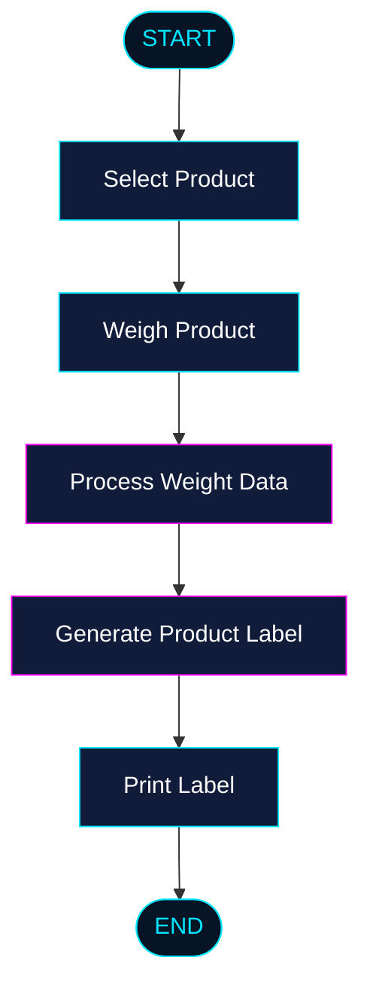

# ⚡ LabelingConsoleApp

<p align="center">
  
</p>

<p align="center">
  
</p>

<p align="center">
  
  
  
  
</p>

<p align="center">
  <b>⚡ WEIGH. PROCESS. PRINT. ⚡</b>
</p>

---

## 🌌 About The Project

**LabelingConsoleApp** is a C# console application built on **.NET 8**, designed to handle product weighing and label printing.

The application provides a solution for processing weighed products and generating labels containing information about the weighed items.

Its purpose is to simplify the weighing and labeling workflow while providing a lightweight and straightforward console-based environment.

### 🎯 Main Goals

- ⚖️ Product weighing.
- 🏷️ Generating product labels.
- 🖨️ Printing labels for weighed products.
- ⚡ Streamlining the weighing and labeling process.

---

## 🛠️ Tech Stack

<p align="center">
  
</p>

| Technology | Description |
|:---|:---|
| 💜 C# | Main programming language |
| ⚡ .NET 8 | Application framework |
| 💻 Console | Application interface |
| 🛠️ Visual Studio | Development environment |
| 🐙 Git | Version control |

---

## ⚙️ Features

| Feature | Description |
|:---|:---|
| ⚖️ Product Weighing | Handles product weighing |
| 🏷️ Label Generation | Generates labels for weighed products |
| 🖨️ Label Printing | Prints product labels |
| 💻 Console Interface | Lightweight command-line application |
| 🚀 .NET 8 | Built on modern .NET technology |

---

## 📋 Requirements

Before running the application, make sure you have:

- [.NET 8 SDK](https://dotnet.microsoft.com/download/dotnet/8.0)
- [Git](https://git-scm.com/)
- A compatible operating system (Windows, Linux or macOS)

---

## 🚀 Installation

### 1. Clone the repository

```bash
git clone https://github.com/BudynRadzik/LabelingConsoleApp.git
```

### 2. Navigate to the project directory

```bash
cd LabelingConsoleApp
```

### 3. Restore dependencies

```bash
dotnet restore
```

### 4. Build the application

```bash
dotnet build
```

### 5. Run the application

```bash
dotnet run
```

---

## 🏗️ Project Workflow

The general purpose of the application can be represented by the following workflow:



---

## 📂 Project Structure

```text
LabelingConsoleApp/
│
├── 📁 Properties/
├── 📄 Program.cs
├── 📄 LabelingConsoleApp.csproj
└── 📄 README.md
```

*Note: This is an illustrative starting structure. Adjust it to match the actual repository.*

---

## 🔧 Configuration

The application targets **.NET 8**.

Project configuration is managed through the `.csproj` file.

```xml
<TargetFramework>net8.0</TargetFramework>
```

---

## 📸 Screenshots

<p align="center">
  <i>Application screenshots coming soon...</i>
</p>

<!-- Add screenshots here when available:
<p align="center">
  
</p>
-->

---

## 🗺️ Roadmap

- [x] Initial project setup
- [x] .NET 8 foundation
- [ ] Expand product weighing workflow
- [ ] Improve label generation
- [ ] Expand printer integration
- [ ] Add application documentation
- [ ] Add screenshots and usage examples

---

## 🤝 Contributing

Contributions, suggestions and improvements are welcome!

1. Fork the repository.
2. Create a feature branch.
3. Commit your changes.
4. Push your branch.
5. Open a Pull Request.

---

## 📜 License

No license information has been specified yet.

---


<p align="center">
  <a href="https://github.com/BudynRadzik">
    
  </a>
  <a href="https://github.com/BudynRadzik/LabelingConsoleApp">
    
  </a>
</p>

---

<p align="center">
  
</p>

<p align="center">
  <b>⚡ LABELING CONSOLE APP ⚡</b><br/>
  <sub>Precision • Efficiency • Technology</sub>
</p>
