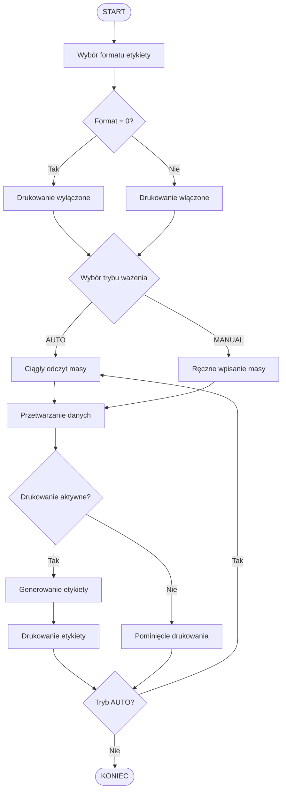

<div align="center">

</div>

## 🗺️ Nawigacja po projekcie 	

| Sekcja | Opis |
|---|---|
| [O projekcie](#o-projekcie) | Cel i zastosowanie aplikacji |
| [Technologie](#wykorzystane-technologie) | Stack technologiczny |
| [Funkcjonalności](#funkcjonalności) | Najważniejsze możliwości |
| [Wymagania](#wymagania) | Oprogramowanie i sprzęt |
| [Instalacja](#instalacja-i-uruchomienie) | Uruchomienie projektu |
| [Przepływ działania](#przepływ-działania-aplikacji) | Schemat procesu |
| [Tryby ważenia](#tryby-ważenia) | Ciągły i Manualny |
| [Drukowanie etykiet](#drukowanie-etykiet) | Konfiguracja drukarki |
| [Menu aplikacji](#menu-aplikacji) | Dostępne opcje |
| [Konfiguracja](#konfiguracja-i-testowanie) | Testowanie bez urządzeń |
| [Plan rozwoju](#plan-dalszego-rozwoju) | Możliwe rozszerzenia |
| [Licencja](#licencja) | Informacje o licencji |

---

<a id="o-projekcie"></a>
<h2>  1. O projekcie 👋 </h2>

**LabelingConsoleApp** to aplikacja konsolowa napisana w języku C# z wykorzystaniem platformy .NET 8.

Jej głównym zadaniem jest obsługa procesu ważenia produktów oraz generowania i drukowania etykiet na podstawie uzyskanej masy.

Aplikacja została przygotowana z myślą o współpracy z urządzeniami wykorzystywanymi w procesie ważenia i etykietowania.

Projekt obsługuje dwa tryby pracy:

- **AUTO** — automatyczny, ciągły odczyt masy z podłączonej wagi.
- **MANUAL** — ręczne wprowadzanie wartości masy przez operatora.

Możliwe jest również uruchomienie aplikacji bez fizycznej wagi i drukarki, w trybie testowym bez drukowania etykiet.

### Testowane urządzenia

| Urządzenie | Model | Komunikacja |
|---|---|---|
| Drukarka etykiet | Zebra LP 2844 | USB, ZPL/EPL |
| Waga | OHAUS DEFENDER 2200 | RS232 / RS232-USB |

---

<a id="wykorzystane-technologie"></a>
<h2> 2. Wykorzystane technologie 🛠️ </h2>

<div align="center">

[](https://skillicons.dev)

</div>

| Technologia | Zastosowanie |
|---|---|
| C# | Główny język programowania |
| .NET 8 | Platforma uruchomieniowa |
| Aplikacja konsolowa | Interfejs użytkownika |
| RS232 / USB | Komunikacja z urządzeniami |
| ZPL / EPL | Obsługa języków drukowania etykiet |

---

<a id="funkcjonalności"></a>
<h2> 3. Funkcjonalności ✨ </h2>

Najważniejsze funkcje aplikacji:

- Automatyczny odczyt masy z wagi.
- Ręczne wprowadzanie wartości masy.
- Przetwarzanie danych dotyczących ważenia.
- Generowanie etykiet produktowych.
- Drukowanie etykiet na kompatybilnej drukarce.
- Wybór formatu etykiety.
- Zmiana liczby drukowanych etykiet.
- Możliwość testowania bez podłączonych urządzeń.
- Obsługa dwóch trybów pracy: AUTO i MANUAL.

---

<a id="wymagania"></a>
<h2> 4. Wymagania 💻 </h2>

### Oprogramowanie

- .NET 8 SDK.
- Środowisko Windows zalecane dla testowanej konfiguracji sprzętowej.
- Terminal lub wiersz poleceń.

### Sprzęt — opcjonalnie

| Urządzenie | Model | Złącze |
|---|---|---|
| Drukarka etykiet | Zebra,Godex... | USB |
| Waga | Każda z RS232 | RS232 lub konwerter RS232/USB |

**Nie posiadasz urządzeń?** Możesz uruchomić aplikację w trybie testowym. Wystarczy wybrać tryb `MANUAL` i ustawić format etykiety na `0`.

---

<a id="instalacja-i-uruchomienie"></a>
<h2> 5. Instalacja i uruchomienie 📦 </h2>

### Krok 1 — Pobranie repozytorium

```bash
git clone https://github.com/BudynRadzik/LabelingConsoleApp.git
```

### Krok 2 — Przejście do katalogu projektu

```bash
cd LabelingConsoleApp
```

### Krok 3 — Przywrócenie zależności

```bash
dotnet restore
```

### Krok 4 — Kompilacja

```bash
dotnet build
```

### Krok 5 — Uruchomienie

```bash
dotnet run
```

---

<a id="przepływ-działania-aplikacji"></a>
<h2> 6. Przepływ działania aplikacji 🧩 </h2>

Poniższy diagram przedstawia główny przebieg pracy programu — od wyboru formatu etykiety, przez pobranie masy, aż do ewentualnego wydrukowania etykiety.



### Przebieg procesu

1. Operator wybiera format etykiety.
2. Następnie wybiera tryb ważenia.
3. Program pobiera masę automatycznie lub przyjmuje wartość wprowadzoną ręcznie.
4. Dane dotyczące masy są przetwarzane.
5. Jeżeli drukowanie jest aktywne, program generuje i drukuje etykietę.
6. W trybie AUTO proces odczytu masy jest kontynuowany w pętli.

---

<a id="tryby-ważenia"></a>
<h2> 7. Tryby ważenia 🧪  </h2>

### AUTO — automatyczne ważenie

Tryb przeznaczony do współpracy z podłączoną wagą.

- Ciągły odczyt wartości masy.
- Automatyczne pobieranie danych z urządzenia.
- Przetwarzanie kolejnych odczytów.
- Możliwość ciągłej pracy aplikacji.

### MANUAL — ręczne ważenie

Tryb umożliwiający pracę bez fizycznego podłączenia wagi.

- Operator samodzielnie wprowadza wartość masy.
- Nie jest wymagane połączenie z urządzeniem pomiarowym.
- Tryb przydatny podczas testowania aplikacji.

---

<a id="drukowanie-etykiet"></a>
 <h2>  8. Drukowanie etykiet 📚 </h2>

Aplikacja umożliwia generowanie i drukowanie etykiet produktowych.

### Testowana drukarka

**Zebra LP 2844**

- Połączenie USB.
- Obsługa języków drukowania ZPL/EPL.

### Format etykiety

Format etykiety określa, czy program ma realizować proces drukowania.

| Format | Działanie |
|---|---|
| `0` | Drukowanie wyłączone |
| Inny skonfigurowany format | Generowanie i drukowanie etykiet |

Dostępne formaty zależą od konfiguracji aplikacji.

---

<a id="menu-aplikacji"></a>
<h2> 9. Menu aplikacji 📜 </h2>

Aplikacja udostępnia menu umożliwiające zmianę wybranych parametrów pracy.

Dostępne opcje obejmują:

- Zmianę formatu etykiety.
- Zmianę liczby etykiet.
- Wybór trybu ważenia.
- Przejście do procesu ważenia.

---

<a id="konfiguracja-i-testowanie"></a>
<h2> 10. Konfiguracja i testowanie ⚙️ </h2>

### Uruchomienie bez wagi i drukarki

Aplikację można przetestować bez podłączania urządzeń zewnętrznych.

W tym celu:

1. Uruchom program.
2. Ustaw format etykiety na `0`,  wyłącza drukowanie etykiet.
   Dzięki temu można sprawdzić działanie aplikacji bez fizycznej drukarki
   Początkowy  tryb ważenia to  `MANUAL` nic nie trzeba zmieniać
3. Wybierz pierwszą opcje `nowe ważenie`
4. Wprowadź ręcznie wartość masy.

### Konfiguracja sprzętowa

W przypadku pracy z urządzeniami:

- Podłącz drukarkę etykiet Zebra ,Godex lub inną obsługująca języki ZPL/ZPL/EZPL/EPL przez USB.
- Odczytaj nazwę drukarki widzianą przez twój komputer, a następnie  w pliku `Program.cs` wpisz tę nazwę w miejsce `{"ZDesigner LP 2844"}`  
- Podłącz wagę  przez RS232 lub konwerter RS232/USB a następnie sprawdź w `Menadżer urządzeń`  którego portu COM używa twoje urządzenie
  Domyślnie w pliku`Program.cs` ustawiony jest port `COM4` i należy  w tym miejscu wpisać  aktualnie używany port COM.
- Upewnij się, że wymagane sterowniki i ustawienia systemowe są poprawnie skonfigurowane.
- Testowy format etykiety znajduje sie w `Program.cs` na liście `List<LabelFormat>` pod `Id = 2`
- Plik z komendami ZPL( rozmieszczeniu elementów na etykiecie) znajduje sie w folderze `Labels`
- Aby wykonać własną etykietę należy utworzyć  w zewnętrznej aplikacji np `Zebra Designer 3` a następnie utworzoną
  etykietę `Wydrukować do pliku` o rozszerzeniu `.prn`  i umieścić  w folderze `Labels`
- Następnie aby użyć utworzoną wcześniej etykietę  w programie należy dodać ją do listy `List<LabelFormat>` w pliku `Program.cs`
   podać kolejne Id , nazwę  oraz przypisać ścieżkę dostępu `Path`
- Dynamiczne pola znajdujące się na etykiecie np. `"{{WEIGHT}}"` lub inne  należy  dodać w  klasie `ZebraUsbLabelPrinter` w oznaczonym miejscu
- Przykład:
-  
  `string payload = template`

  `.Replace("{{WEIGHT}}", weighing.Weight.ToString("0.###", CultureInfo.InvariantCulture))`  
  
  `.Replace("{{DATE}}", weighing.WeighedAt.ToLocalTime().ToString("yyyy-MM-dd "));`  
  
---

<a id="plan-dalszego-rozwoju"></a>
<h2> 11. Plan dalszego rozwoju 🎯 </h2>

Możliwe kierunki rozbudowy projektu:

- [ ] Rozszerzenie konfiguracji drukarek.
- [ ] Obsługa kolejnych modeli drukarek.
- [ ] Integracja z dodatkowymi modelami wag.
- [ ] Rozbudowa obsługi błędów i diagnostyki.
- [ ] Więcej opcji konfiguracyjnych.
- [ ] Elastyczniejsze szablony etykiet.
- [x] Wybór języka aplikacji 

---

<a id="zrzuty-ekranu"></a>
## 12. Zrzuty ekranu

W tej sekcji można umieścić zrzuty ekranu prezentujące działanie aplikacji.

Przykład dodania obrazu:

```markdown

```

---

<a id="licencja"></a>
## 13. Licencja

Informacje o licencji nie zostały jeszcze określone.

---

<div align="center">


</div>
